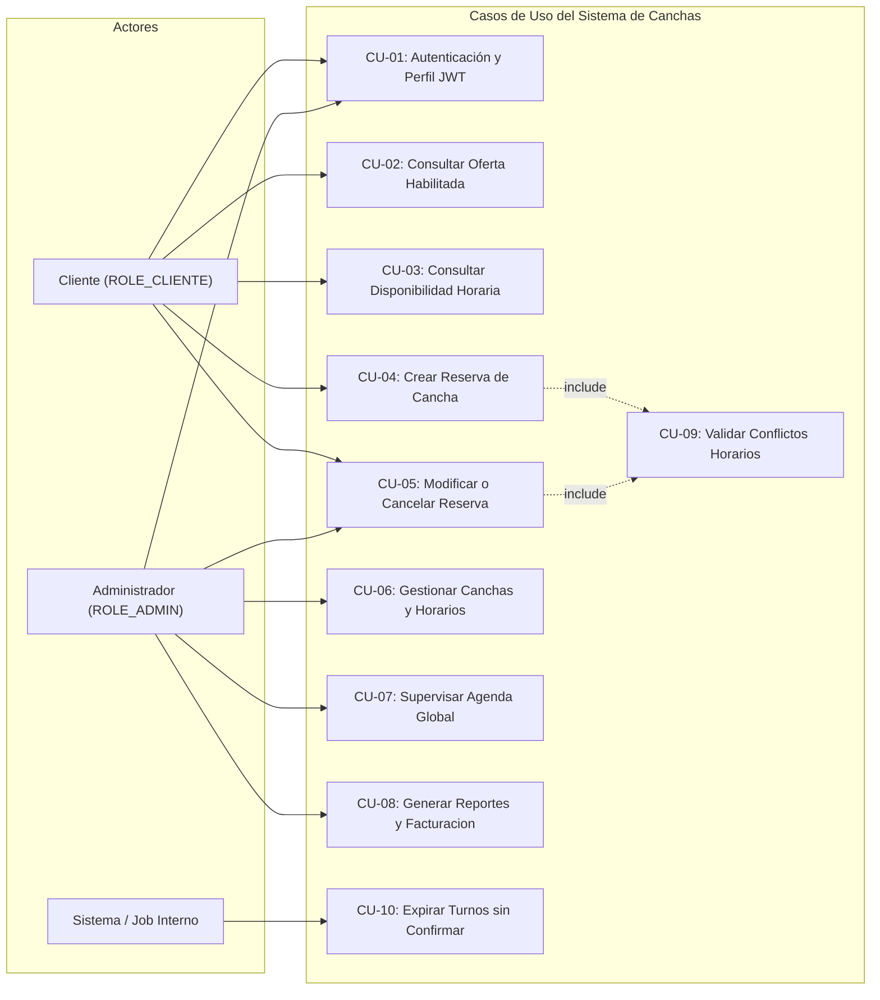
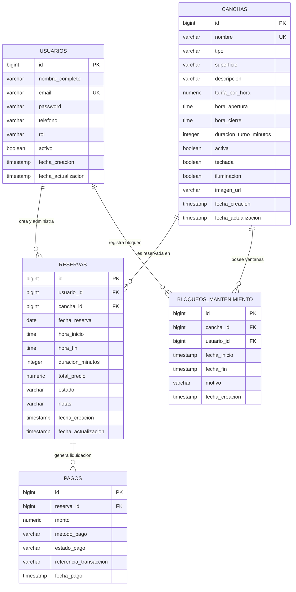
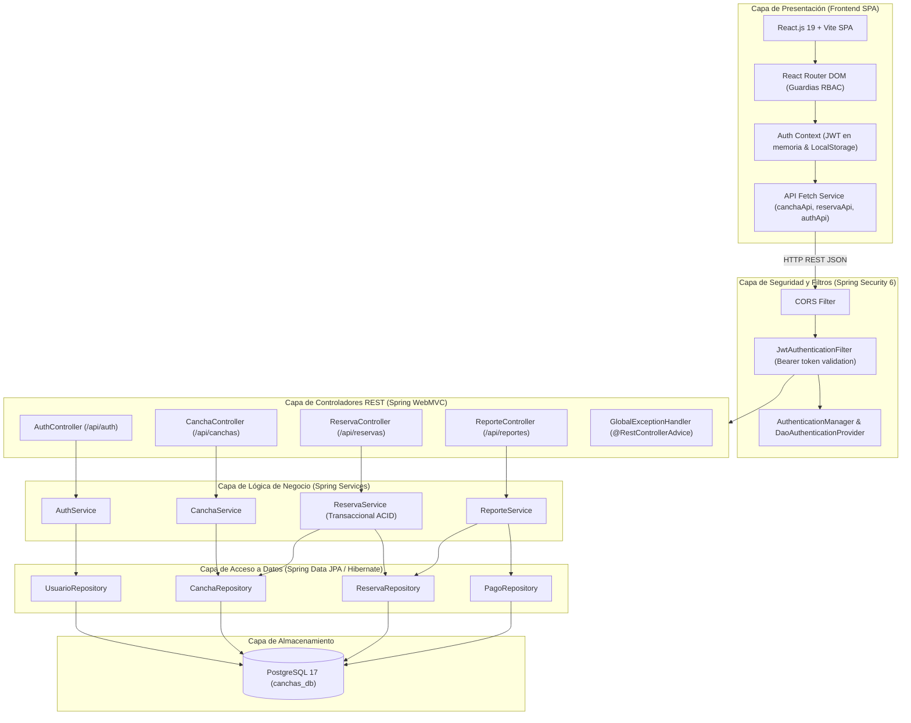
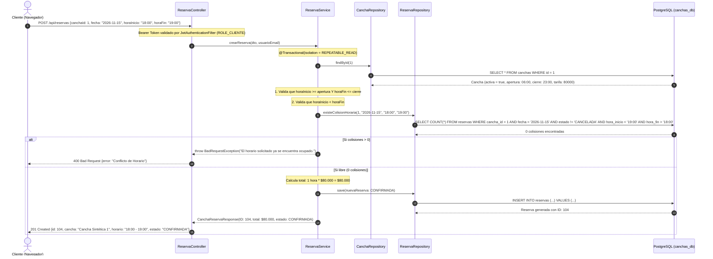

# HU06 — Diseño Funcional, Interfaces y Arquitectura
**Sistema de Gestión y Reserva de Canchas Deportivas**  
*3 Puntos de Estimación (PE) — 24 Horas de Esfuerzo*

---

> ### 🎯 Historia de Usuario
> **«Como equipo de desarrollo, quiero definir el diseño del sistema antes de su implementación, para reducir ambigüedades y facilitar la integración».**
>
> **Criterio de Aceptación:** Diseños coherentes con el alcance general del proyecto y disponibles para orientar de manera inequívoca la implementación técnica.

---

## 📑 Tabla de Contenido
1. [Módulo 1: Casos de Uso y Modelo de Datos (8h)](#1-casos-de-uso-y-modelo-de-datos)
   - 1.1 Actores del Sistema
   - 1.2 Diagrama de Casos de Uso
   - 1.3 Matriz y Especificación Detallada de Casos de Uso
   - 1.4 Modelo Entidad-Relación (ERD)
   - 1.5 Diccionario de Datos Técnico (PostgreSQL)
2. [Módulo 2: Arquitectura, Componentes y Secuencia de Reserva (8h)](#2-arquitectura-componentes-y-secuencia-de-reserva)
   - 2.1 Arquitectura de Software por Capas
   - 2.2 Diagrama de Componentes de Software
   - 2.3 Diagrama de Secuencia: Creación de Reserva con Concurrencia ACID
   - 2.4 Patrones de Diseño de Software Aplicados
3. [Módulo 3: Wireframes y Prototipo de Interfaces Principales (8h)](#3-wireframes-y-prototipo-de-interfaces-principales)
   - 3.1 Wireframe 1: Consulta de Disponibilidad y Selección de Turnos Horarios
   - 3.2 Wireframe 2: Modal de Confirmación y Liquidación de Reserva
   - 3.3 Wireframe 3: Panel "Mis Reservas" (Gestión del Cliente)
   - 3.4 Wireframe 4: Agenda y Reportes de Ocupación (Gestión del Administrador)
4. [Trazabilidad con el Alcance General del Proyecto](#4-trazabilidad-con-el-alcance-general)

---

## 1. Casos de Uso y Modelo de Datos

### 1.1 Actores del Sistema

| Actor | Tipo | Descripción y Responsabilidad |
| :--- | :--- | :--- |
| **Cliente** | Humano / Externo | Usuario final registrado que consulta canchas habilitadas, verifica disponibilidad horaria, crea, modifica y cancela sus reservas personales. |
| **Administrador** | Humano / Privilegiado | Encargado del complejo deportivo que mantiene canchas, configura horarios, tarifas, estados de mantenimiento, supervisa todas las reservas y consulta reportes financieros y de ocupación. |
| **Sistema (Cron/Timer)** | Automático / Interno | Tareas programadas de liberación de reservas expiradas, validación de integridad referencial y auditoría de eventos. |

---

### 1.2 Diagrama de Casos de Uso



---

### 1.3 Matriz y Especificación Detallada de Casos de Uso

#### CU-03: Consulta de Disponibilidad Horaria por Fecha
* **Actor Primario:** Cliente o Administrador.
* **Precondición:** Cancha seleccionada debe estar en estado `activa = true`.
* **Flujo Principal:**
  1. El usuario selecciona una cancha y una fecha específica (ej. `2026-11-15`).
  2. El sistema recupera el rango laboral de la cancha (`horaApertura` a `horaCierre`) y la duración del turno (ej. 60 min).
  3. El sistema consulta las reservas existentes en esa fecha para la cancha con estados `CONFIRMADA` o `PENDIENTE`.
  4. El sistema genera los intervalos horarios y marca cada uno como:
     - `LIBRE`: Disponible para reserva inmediata.
     - `OCUPADO`: Rango con reserva activa no cancelada.
     - `NO_DISPONIBLE`: Fuera de horario laboral o en ventana de mantenimiento.
  5. Se retorna la grilla de disponibilidad estructurada al cliente.

#### CU-04: Creación de Reserva con Validación de Disponibilidad
* **Actor Primario:** Cliente autenticado.
* **Precondición:** Token JWT vigente y fecha/hora futura.
* **Reglas de Negocio Estrictas:**
  - **RN-01:** La hora de inicio debe ser estrictamente menor a la hora de fin.
  - **RN-02:** El intervalo solicitado no puede solaparse ni en 1 minuto con una reserva previa activa (`hora_inicio < nuevaFin AND hora_fin > nuevaInicio`).
  - **RN-03:** El costo total se calcula automáticamente: `duracion_en_horas * tarifaPorHora`.
  - **RN-04:** El usuario no puede reservar si su cuenta se encuentra inactiva.
* **Postcondición:** Se persiste la reserva en estado `CONFIRMADA`, se bloquea el intervalo y se genera código único de reserva.

---

### 1.4 Modelo Entidad-Relación (ERD)



---

### 1.5 Diccionario de Datos Técnico (PostgreSQL 17)

#### Tabla: `reservas`
Almacena las solicitudes y reservas formales de canchas.

| Campo | Tipo de Dato | Nulo | Restricciones / Defecto | Descripción |
| :--- | :--- | :---: | :--- | :--- |
| `id` | `BIGSERIAL` | No | PK | Identificador numérico único de la reserva. |
| `usuario_id` | `BIGINT` | No | FK `usuarios(id)` ON DELETE RESTRICT | Cliente que solicitó y es titular de la reserva. |
| `cancha_id` | `BIGINT` | No | FK `canchas(id)` ON DELETE RESTRICT | Cancha deportiva reservada. |
| `fecha_reserva` | `DATE` | No | Check: `>= CURRENT_DATE` | Día del turno a disputar. |
| `hora_inicio` | `TIME` | No | Check: `< hora_fin` | Hora exacta de inicio del partido/turno. |
| `hora_fin` | `TIME` | No | - | Hora exacta de culminación del partido/turno. |
| `duracion_minutos`| `INTEGER` | No | Defecto: `60`, Min: `30` | Duración efectiva en minutos calculada. |
| `total_precio` | `NUMERIC(12,2)`| No | Check: `> 0` | Importe total liquidado de acuerdo a la tarifa horaria. |
| `estado` | `VARCHAR(25)` | No | `CONFIRMADA`, `PENDIENTE`, `CANCELADA`, `FINALIZADA` | Estado operativo de la reserva. |
| `notas` | `VARCHAR(500)` | Sí | - | Observaciones o requisitos adicionales del cliente. |
| `fecha_creacion` | `TIMESTAMP` | No | `NOW()` | Auditoría de creación. |
| `fecha_actualizacion`| `TIMESTAMP` | Sí | `NOW()` | Auditoría de última modificación. |

> [!IMPORTANT]
> **Índice de Rendimiento para Detección de Colisiones Horarias:**  
> `CREATE INDEX idx_reservas_solapamiento ON reservas (cancha_id, fecha_reserva, hora_inicio, hora_fin) WHERE estado IN ('CONFIRMADA', 'PENDIENTE');`

---

## 2. Arquitectura, Componentes y Secuencia de Reserva

### 2.1 Arquitectura de Software por Capas

El sistema se estructura bajo una **Arquitectura en Capas desacoplada**, con comunicación asíncrona mediante JSON sobre HTTPS:



---

### 2.2 Diagrama de Secuencia: Creación de Reserva con Concurrencia ACID

Este flujo garantiza que dos clientes no puedan reservar la misma cancha a la misma hora, resolviendo condiciones de carrera (*Race Conditions*):



---

## 3. Wireframes y Prototipo de Interfaces Principales

### 3.1 Wireframe 1: Consulta de Disponibilidad y Selección de Turnos
Permite al cliente visualizar el calendario, seleccionar día y elegir visualmente el turno horario disponible:

```
+---------------------------------------------------------------------------------------+
|  CanchasPro                 [Catálogo]  [Disponibilidad]  [Mis Reservas]   (Carlos C.)|
+---------------------------------------------------------------------------------------+
|  <- Volver al Catálogo                                                                |
|                                                                                       |
|  CANCHA SINTÉTICA 1 - LA BOMBONERA (Fútbol 5)                                         |
|  Tarifa: $80.000 / hora  |  Horario: 06:00 - 23:00  |  Superficie: Sintética 50mm     |
|                                                                                       |
|  [ FECHA: [ 15 / Nov / 2026 ] < Hoy > < Siguiente > ]                                 |
|                                                                                       |
|  ESTADO DE TURNOS:  [V] Libre (Verde)   [X] Ocupado (Gris)   [*] Seleccionado (Azul)  |
|                                                                                       |
|  +----------------+  +----------------+  +----------------+  +----------------+       |
|  |  06:00 - 07:00 |  |  07:00 - 08:00 |  |  08:00 - 09:00 |  |  09:00 - 10:00 |       |
|  |     [LIBRE]    |  |     [LIBRE]    |  |   [OCUPADO]    |  |     [LIBRE]    |       |
|  +----------------+  +----------------+  +----------------+  +----------------+       |
|  +----------------+  +----------------+  +----------------+  +----------------+       |
|  |  16:00 - 17:00 |  |  17:00 - 18:00 |  |  18:00 - 19:00 |  |  19:00 - 20:00 |       |
|  |     [LIBRE]    |  |   [OCUPADO]    |  | [*SELECCIONADO*|  |   [OCUPADO]    |       |
|  +----------------+  +----------------+  +----------------+  +----------------+       |
|                                                                                       |
|  Resumen Preliminar: Turno de 18:00 a 19:00 seleccionado (1 hora). Total: $80.000    |
|  [ Continuar y Confirmar Reserva -> ]                                                 |
+---------------------------------------------------------------------------------------+
```

---

### 3.2 Wireframe 2: Modal de Confirmación y Liquidación
Ventana flotante donde se verifica el importe, los datos del cliente y se confirma la reserva:

```
+-----------------------------------------------------------------------------+
|  CONFIRMAR RESERVA DE CANCHA                                           [ X ]|
+-----------------------------------------------------------------------------+
|                                                                             |
|  Detalles de la Cancha:                                                     |
|  - Cancha: Cancha Sintética 1 - La Bombonera                                |
|  - Deporte: Fútbol 5  |  Superficie: Césped Sintético                        |
|                                                                             |
|  Horario del Partido:                                                       |
|  - Fecha: Domingo, 15 de Noviembre de 2026                                   |
|  - Intervalo: 18:00 - 19:00 (60 minutos)                                    |
|                                                                             |
|  Titular de la Reserva:                                                     |
|  - Nombre: Carlos Valderrama  |  Teléfono: 310 123 4567                     |
|  - Correo: carlos.cliente@gmail.com                                         |
|                                                                             |
|  Liquidación:                                                               |
|  - Tarifa por hora:            $ 80.000                                     |
|  - Horas reservadas:           1.0 hora                                     |
|  -------------------------------------------------------------              |
|  TOTAL A PAGAR:                $ 80.000 COP                                 |
|                                                                             |
|  Notas adicionales (Opcional):                                              |
|  [ Requerimos balones y chalecos reflectivos...            ]                |
|                                                                             |
|  [ Cancelar ]                             [ CONFIRMAR Y CREAR RESERVA -> ]  |
+-----------------------------------------------------------------------------+
```

---

### 3.3 Wireframe 3: Panel "Mis Reservas" (Gestión del Cliente)
Espacio personal donde el cliente consulta el historial de sus reservas, sus estados y opciones de cancelación:

```
+---------------------------------------------------------------------------------------+
|  CanchasPro                 [Catálogo]  [Mis Reservas (3)]   [Perfil]      (Carlos C.)|
+---------------------------------------------------------------------------------------+
|  MIS RESERVAS DEPORTIVAS                                                              |
|  Gestiona tus partidos programados y consulta tu historial                            |
|                                                                                       |
|  Filtro: [ Todas ] [ Próximas ] [ Finalizadas ] [ Canceladas ]                        |
|                                                                                       |
|  +---------------------------------------------------------------------------------+  |
|  | CANCHA SINTÉTICA 1 - LA BOMBONERA                           [ CONFIRMADA - Verde] |  |
|  | Fecha: 15/Nov/2026  |  Horario: 18:00 - 19:00  |  Valor: $80.000 COP             |  |
|  | Dirección: Complejo Deportivo Sede Norte                                        |  |
|  | Acciones: [ Ver Comprobante ]   [ Cancelar Reserva ]                            |  |
|  +---------------------------------------------------------------------------------+  |
|                                                                                       |
|  +---------------------------------------------------------------------------------+  |
|  | PISTA DE PÁDEL PANORÁMICA                                  [ FINALIZADA - Azul ] |  |
|  | Fecha: 28/Oct/2026  |  Horario: 19:00 - 20:00  |  Valor: $75.000 COP             |  |
|  | Acciones: [ Ver Detalle ]   [ Calificar Cancha ]                                |  |
|  +---------------------------------------------------------------------------------+  |
+---------------------------------------------------------------------------------------+
```

---

### 3.4 Wireframe 4: Agenda y Reportes de Ocupación (Gestión del Administrador)
Panel exclusivo para supervisión integral del complejo:

```
+---------------------------------------------------------------------------------------+
|  CanchasPro (Admin)     [Dashboard]  [Gestión Canchas]  [Agenda Reservas]  [Reportes] |
+---------------------------------------------------------------------------------------+
|  AGENDA GENERAL DEL COMPLEJO DEPORTIVO                                                |
|  Día: [ 15 / Nov / 2026 ]   Vista: [ Por Cancha | Día Completo ]                      |
|                                                                                       |
|  KPIs del Día:  Reservas Hoy: 14   |   Ocupación: 78%   |   Recaudación: $1.150.000   |
|                                                                                       |
|  HORA    | CANCHA 1 (FUT 5) | CANCHA 2 (FUT 7) | TENIS CENTRAL | PÁDEL PANORÁMICA     |
|  --------+------------------+------------------+---------------+------------------    |
|  16:00   | [ LIBRE ]        | [ O. Rodríguez ] | [ LIBRE ]     | [ P. Gómez ]         |
|  17:00   | [ LIBRE ]        | [ O. Rodríguez ] | [ J. Pérez ]  | [ LIBRE ]            |
|  18:00   | [ C. Valderrama] | [ LIBRE ]        | [ J. Pérez ]  | [ LIBRE ]            |
|  19:00   | [ F. García ]    | [ Torneo Club ]  | [ LIBRE ]     | [ M. Yepes ]         |
|  20:00   | [ F. García ]    | [ Torneo Club ]  | [ LIBRE ]     | [ M. Yepes ]         |
|                                                                                       |
|  [ + Crear Reserva Manual en Taquilla ]          [ Descargar Reporte en Excel/PDF ]   |
+---------------------------------------------------------------------------------------+
```

---

## 4. Trazabilidad con el Alcance General del Proyecto

| Requisito Funcional del Proyecto | Estado / Cobertura en la Arquitectura HU06 |
| :--- | :--- |
| **Registro de usuarios y administradores** | Cubierto en HU01 (`Usuario`, Spring Security JWT, procedimiento seguro de administradores con clave maestra). |
| **Gestión de canchas (tipos, horarios, tarifas)** | Cubierto en HU03 (`Cancha`, `TipoCancha`, CRUD completo, validación cronológica y activación/desactivación). |
| **Reservas (crear, modificar, cancelar)** | Especificado en HU06 (CU-04, CU-05, entidad `Reserva`, estados `CONFIRMADA/CANCELADA`). |
| **Validación de disponibilidad** | Especificado en HU06 (Algoritmo de detección de colisiones horarias, transaccionalidad `REPEATABLE_READ`). |
| **Acceso por roles** | Implementado con Spring Security (`ROLE_CLIENTE` vs `ROLE_ADMIN`). |
| **Reportes básicos de uso y facturación** | Especificado en HU06 (CU-08, entidad `Pago`, métricas de ocupación e ingresos por cancha). |

---
*Fin del documento de diseño funcional, interfaces y arquitectura (HU06).*

